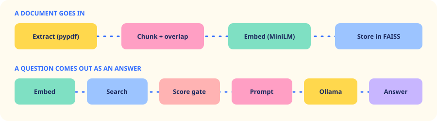

<p align="center">
  
</p>

<p align="center">
  
  
  
  
</p>

Panna is a local RAG chatbot in the body of a thick, torn old register. Add a PDF or TXT, ask a question, and read the answer with the source text beside it. If the document does not say it, Panna refuses instead of inventing an answer.

## How it works

<p align="center">
  
</p>

Two guards stop made-up answers:

1. **Score gate:** if no passage is close enough, the model is never called.
2. **Prompt rule:** the model must use only the retrieved passages, or give a fixed refusal sentence.

## What is inside

| Tab | What it does |
|---|---|
| **Guide** | A five-page tour of the app and its backend |
| **Chat** | Animated answers, citations and source text. New page turns the paper |
| **Papers** | Upload, the four reading stages and the Chunk Explorer |
| **Engine** | The question's journey, Retrieval Lab, index map and exact prompt |
| **Studio** | 9 looks including Bubblegum, plus fonts, ink, motion, layout and 5 robots |
| **Keys** | Ollama, plus optional online providers |
| **Marks** | The assignment rubric, Show me buttons and a five-question Test Bench |

## Run it on Windows

Install these once, with internet:

1. **Python 3.13** from [python.org](https://www.python.org/downloads/). Tick "Add python.exe to PATH".
2. **Ollama** from [ollama.com/download](https://ollama.com/download).

Then open a terminal:

```
git clone https://github.com/SHAILESH-RS-UPADHYAY/panna-rag.git
cd panna-rag
ollama pull llama3.2
python -m venv .venv
.venv\Scripts\activate
pip install -r requirements.txt
python run.py
```

The browser opens at http://127.0.0.1:7860. The first start also downloads the embedding model (about 90 MB). Expect about 3 to 4 GB of downloads in total. After that it works offline.

To run it again later:

```
.venv\Scripts\activate
python run.py
```

On a slow laptop, run `ollama pull llama3.2:1b` and choose that model in the Keys tab.

## Project layout

```
rag/       Python backend: ingest, store, prompt, llm, pipeline, server
web/       The frontend, with no build step
samples/   A sample handbook to try
tests/     test_rag.py and five_questions.py
docs/      PRD, ARD, plan and marks guide
```

## Tests

```
python tests/test_rag.py
python tests/five_questions.py
```

The second needs Ollama running. It writes the model's real answers to `submission/test_results.md`.

## Credits

Most icons are from Pepicons Pencil (CC BY 4.0). Fonts are from Google Fonts (SIL Open Font License).
